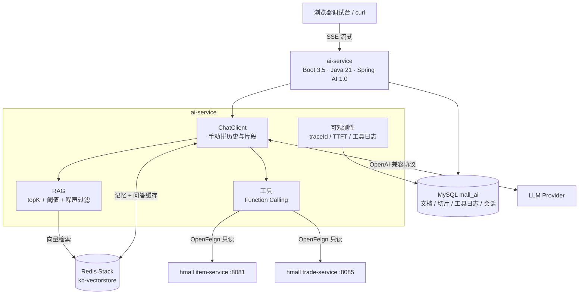
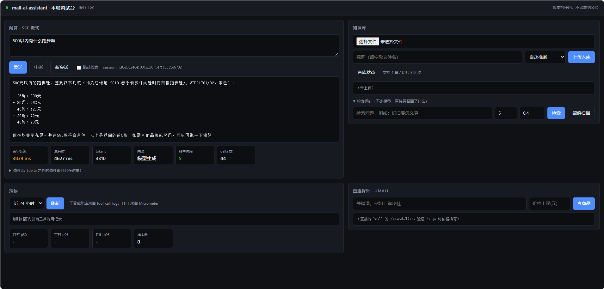
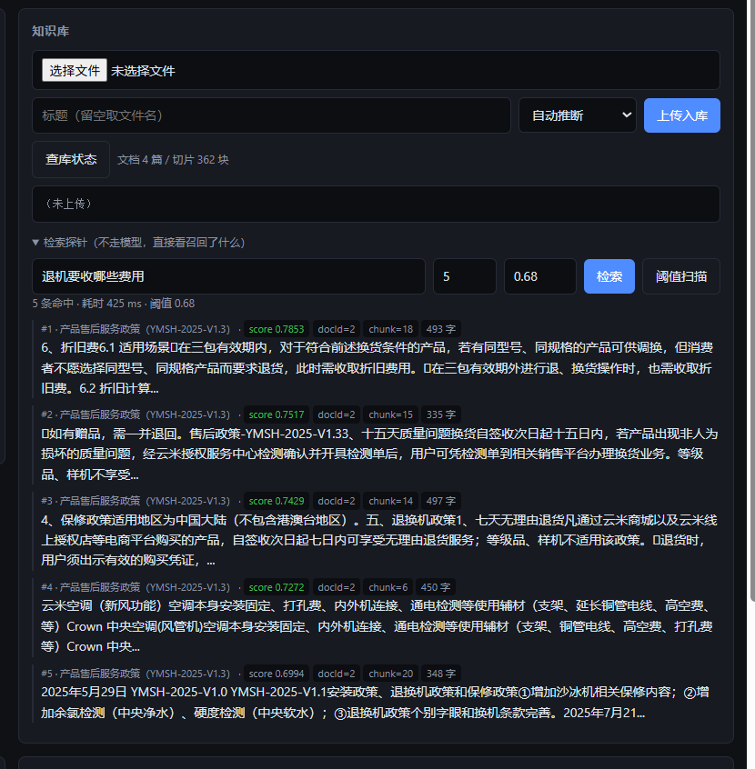
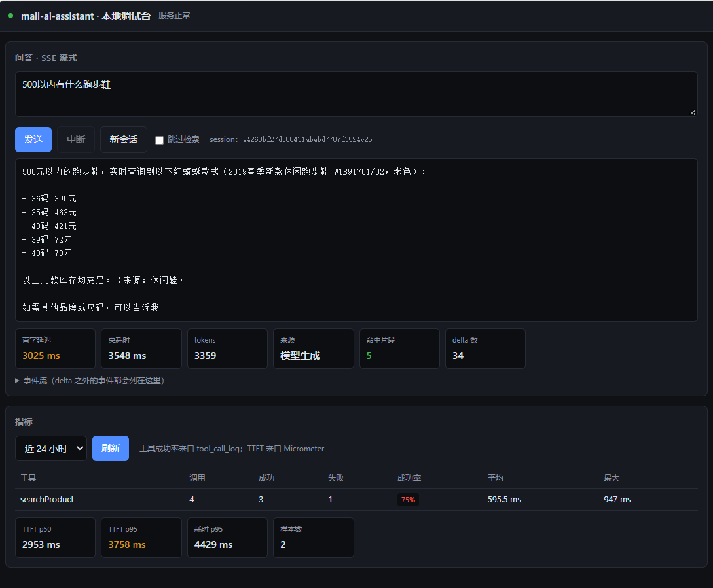

# mall-ai-assistant

> 在**不改动链路**的前提下，给现有电商微服务加一层 AI 能力：自然语言找商品、查库存、问订单、答售后。

**技术栈**：Java 21 · Spring Boot 3.5 · Spring AI 1.0 · Spring Cloud OpenFeign · Redis Stack（向量库）· MyBatis-Plus · MySQL
**状态**：8 步全部完成，30 条评测集 **86.7%** 通过（`docs/eval-report.md`）　|　▶ [演示视频（v1.0.0）](https://github.com/aHuaiUU/mall-ai-assistant/releases/tag/v1.0.0)

## 这个项目解决什么问题

电商的检索和售后是「关键词搜索 + 人工客服」。用户真实的表达是「有没有适合跑步的鞋，500 以内，能退换吗」——一句话里含**品类、预算、售后政策**三个意图，关键词只能命中第一个。

本项目验证一件事：**能不能用 AI 服务把自然语言翻译成「查知识库 + 查业务接口」的组合动作，且不动交易系统一行代码。**

| 场景 | 用户说 | 系统动作 |
|---|---|---|
| 商品导购 | 「500 以内适合跑步的鞋」 | 工具调 hmall 商品接口，按价格+关键词过滤 |
| 售后咨询 | 「买错了能退吗」 | RAG 检索售后政策，带出处回答 |
| 订单查询 | 「我昨天的订单到哪了」 | 工具调 hmall 订单接口（缺单号时索要） |

## 架构



**三条边界**：① AI 层不直连商品库，只走既有只读接口；② 业务库与 AI 库物理分离；③ AI 服务挂掉不影响交易。

## 关键设计决策

> 每条只给结论，完整论证见 [`docs/architecture.md`](docs/architecture.md)。

1. **独立进程，不并入 hmall**——版本要求冲突（Boot 2.7+JDK11 vs Boot 3.5+JDK21）只是表面原因；真正原因是模型调用有秒级延迟、按 token 计费、会限流超时，不该和下单链路共享线程池。
2. **向量库复用 Redis Stack，不引 Milvus**——万级 chunk 量级，HNSW 够用，且 Redis 本就在依赖里，零新增运维。
3. **RAG 管文档，工具管实时数据**——价格/库存/订单必须查库；商品目录导出时刻意不含价格库存，避免「知识库快照过期后答错价」。
4. **工具只暴露读操作**——`ItemClient`/`TradeClient` 里没有 PUT/POST 方法，模型误判的代价是「查错了」而不是「删了数据」。这条落在接口层，不靠提示词。
5. **SSE 而非 WebSocket**——回答是单向流推，SSE 走标准 HTTP，网关/Nginx/浏览器原生支持。
6. **traceId 显式传递，不依赖 ThreadLocal**——一条问答跨四个线程边界（Servlet → boundedElastic → Reactor 回调 → 工具线程），MDC 每跳都丢。
7. **记忆与缓存边界定死**——记忆只存「提问+最终回答」（按轮裁到 5 轮）；缓存只缓存「无历史 + 命中静态文档」的问答，key 里掺知识库版本号做失效。

## 实测数据

> 30 条评测集，真实环境（虚拟机 MySQL/Redis/RabbitMQ + hmall item/trade-service + 千问 MaaS）。明细见 [`docs/eval-report.md`](docs/eval-report.md)。

| 类别 | 通过 | 通过率 |
|---|---|---|
| A 政策问答 | 6/6 | 100% |
| B 商品参数 | 6/6 | 100% |
| C 混合意图 | 2/6 | **33%** ← 已知短板 |
| D 工具调用（价格/库存/订单） | 6/6 | 100% |
| E 超范围拒答 | 6/6 | 100% |
| **合计** | **26/30** | **86.7%** |

| 性能（同一轮 30 条） | p50 | p95 |
|---|---|---|
| 首字延迟 TTFT | 1576 ms | 5613 ms |
| 端到端耗时 | 2334 ms | 6341 ms |

- 平均 tokens 2586；30 次请求中 9 次触发工具调用
- 缓存命中：`costMs` 4528 → **753**（分块回放保持打字机效果）
- 工具链路可追溯：响应头 `X-Trace-Id` == `tool_call_log.trace_id`

**演进过程**（同一套用例）：原始评测脚本 33% → 修测量方法 60% → 修提示词/缓存/阈值 70% → 修判定规则 76.7% → 扩大候选池+补订单工具 **86.7%**。

## 已知限制

1. **混合意图（C 类 33%）**：问题里带商品词时，政策片段会被 341 块商品语料挤出 top5。正解是查询分解或按来源分路检索。
2. **商品粒度粗**：chunk 每块 3-4 款商品，无法稳定精确到单个 SKU，需按商品切分重建索引。
3. **无登录体系**：订单查询未校验归属（hmall 的 `GET /orders/{id}` 是内部接口），接入 JWT 后应在工具里补校验。
4. **工具轮次无代码上限**：目前只靠提示词约束「最多调一次」。

## 运行截图

一个页面集成四块能力：流式问答、知识库、指标、直连探针（`ai-service/src/main/resources/static/index.html`，仅本机使用）。

### 流式问答



首字 3839ms / 总耗时 4627ms / 命中片段 5 / delta 44 条——逐字输出，不是等全文生成再一次性返回。

### 检索探针：阈值调优的证据



「退机要收哪些费用」在阈值 **0.68** 下命中 5 条，**全部是政策片段**（score 0.70~0.75，`docId=2`）。
这正是 `fetch-multiplier` 2→8 修复后的效果——修复前 top5 全是商品片段（0.69），政策片段虽然分数更高却进不了候选（原因见 [`docs/pitfalls.md`](docs/pitfalls.md) 第 18 条）。

### 指标面板



工具成功率来自 `tool_call_log` 聚合 SQL，TTFT / 耗时来自 Micrometer 的 Prometheus 端点。

## 目录结构

```
mall-ai-assistant/
├── ai-service/                      # AI 能力层（Boot 3.5 + Java 21）
│   └── src/main/java/com/mall/ai/
│       ├── config/                  # ChatClient、Feign、向量库
│       ├── controller/              # 问答 SSE、知识库、指标、开发探针
│       ├── service/                 # 入库编排、RAG、问答编排、记忆、缓存、归档、工具日志
│       ├── tool/                    # @Tool：searchProduct / queryOrder
│       ├── client/                  # OpenFeign → hmall 只读接口
│       ├── reader/                  # 解析、归一化、切分、片段质量过滤
│       ├── filters/                 # TraceIdFilter
│       └── entity/ mapper/ dto/     # 5 张表与 VO
│   └── src/main/resources/
│       ├── prompts/system.st        # 系统提示词
│       ├── mapper/*.xml             # 复杂 SQL
│       └── static/index.html        # 本地调试台
├── sql/schema.sql                   # mall_ai：5 张表 DDL
├── data/catalog/                    # 商品静态参数（3 类目 × 400 款）
├── data/eval/                       # 30 条评测集 + 用例说明
├── tools/                           # 评测器、用例校验器、目录导出脚本
├── docs/
│   ├── architecture.md              # 施工图：表结构、Redis key、SSE 协议、设计论证
│   ├── eval-report.md               # 评测方法与数据
│   ├── pitfalls.md                  # 29 条实测踩坑（含环境、契约、评测）
│   └── images/                      # 运行截图（README 引用）
└── README.md
```

> **hmall 不在本仓库**：它是课程基线项目，以独立进程运行（Boot 2.7 + JDK 11），本项目对它只做只读调用 + 一处启动 bug 修复（见 `docs/pitfalls.md` 第 14 条）。

## 快速开始

```bash
# 依赖：JDK 21 · MySQL 8 · Redis Stack（需 RediSearch）· hmall item/trade-service 已运行

# 1. 建库建表
mysql -u root -p < sql/schema.sql

# 2. 准备凭据（.env 已被 .gitignore 忽略）
cp ai-service/.env.example ai-service/.env   # 填 MYSQL_* / REDIS_* / OPENAI_BASE_URL / OPENAI_API_KEY

# 3. 启动（必须在仓库根目录：application.yaml 里 import 的是 ./ai-service/.env）
mvn -f ai-service/pom.xml spring-boot:run

# 4. 打开调试台：http://localhost:9091/index.html
```

```bash
# 命令验证 SSE（中文交给 curl 编码）
curl -N -X POST "http://localhost:9091/api/chat/stream" \
  -H "Content-Type: application/json" \
  --data-binary '{"message":"退货需要保留吊牌吗"}'
# 判据：event:delta 逐条滚动，末尾恰好一个 event:done，响应头带 X-Trace-Id
```

## 文档

| 文档 | 内容 |
|---|---|
| [docs/architecture.md](docs/architecture.md) | 模块职责、数据模型、Redis 结构、SSE 事件协议、Feign 契约、设计论证 |
| [docs/eval-report.md](docs/eval-report.md) | 30 条评测集的设计、判定规则、阈值扫描、性能数据、失败归因 |
| [docs/pitfalls.md](docs/pitfalls.md) | 29 条实测踩坑：环境、契约、RAG、SSE、可观测性、评测 |

## 来源与致谢

商品与订单微服务基于 [黑马程序员 hmall 商城](https://github.com/) 二次开发，**AI 能力层为独立实现**。本项目用于验证「AI 接入既有 Java 微服务体系」的可行性，不用于生产。

## License

MIT
