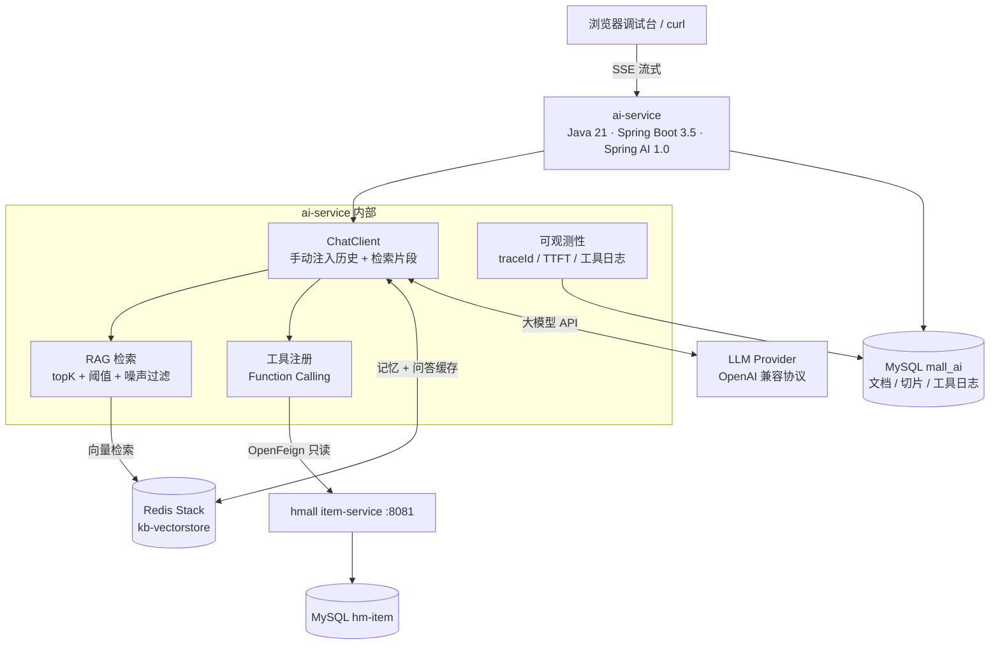
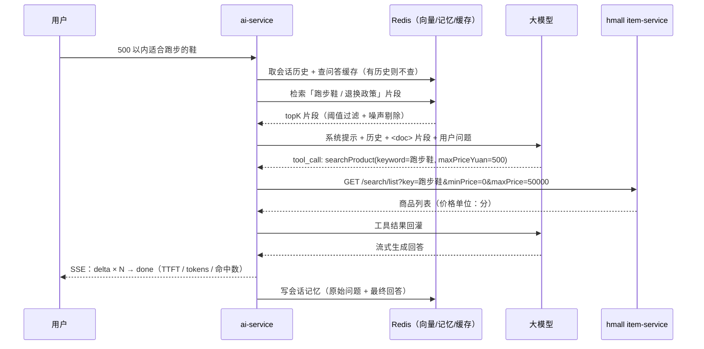

# mall-ai-assistant

> 把 AI 能力接入现有电商微服务系统：用自然语言找商品、查库存、问订单、答售后。

**状态**：8 步计划完成 **7 步**（2026.11）　|　**技术栈**：Java 21 · Spring Boot 3.5.15 · Spring AI 1.0 · Spring Cloud 2025 · Redis Stack（向量库）· MyBatis-Plus

---

## 这个项目解决什么问题

电商系统里的商品检索和售后咨询，传统做法是「关键词搜索 + 人工客服」。用户真正的表达是「有没有适合跑步的鞋，500 以内，能退换吗」——这句话里有**品类、预算、售后政策**三个意图，关键词搜索只能命中第一个。

这个项目要验证一件事：**能不能在不改动现有交易链路的前提下，用 AI 服务把自然语言请求翻译成「查库 + 查知识库」的组合动作。**

三个典型场景：

| 场景 | 用户说 | 系统要做 |
|---|---|---|
| 商品导购 | 「500 以内适合跑步的鞋」 | 调商品服务按价格与品类过滤，返回 Top N |
| 售后咨询 | 「买错了能退吗」 | 检索售后政策知识库，带出处回答 |
| 订单查询 | 「我昨天的订单到哪了」 | 调订单服务查物流状态（工具已预留，`TradeClient` 只读） |

## 架构



**分层原则**：

- `ai-service` 只做「理解意图 + 编排调用」，**不直接连商品库**；
- 数据归口仍在原有微服务，AI 层通过 OpenFeign 走既有只读接口；
- 知识类问题走 RAG，实时数据走工具调用，两者不混用。

## 一次完整调用



## 关键设计决策

> 这一节记录「为什么这么做」，比代码本身更能说明问题。面试时会被追问的也在这里。

**1. AI 服务独立部署，不并入交易微服务**

直接原因是版本约束：hmall 是 Spring Boot 2.7 + Java 11，Spring AI 1.0 要求 Boot 3.x + Java 17+，合并需要把整条链路升到 `jakarta` 命名空间，风险与收益不成比例。

更重要的原因是架构：模型调用有**秒级延迟、按 token 计费、供应商会限流超时**，这三件事都不该和下单链路共享线程池。AI 服务独立后可以单独限流、单独扩容、单独降级——模型挂了不影响交易。

**2. 向量库复用 Redis，不引入 Milvus**

商品知识库是万级 chunk 量级，Redis Stack 的 HNSW 索引完全够用，而 Redis 本来就在 hmall 的依赖里，零新增运维成本。

什么时候该换：需要**混合检索（BM25 + kNN）**或中文分词调优时，ES 的 `dense_vector` 更合适；数据量到百万级 chunk 再考虑专用向量库。

**3. 技术选型用 Spring AI，不用 Python + LangChain**

团队主栈是 Java，为了接 AI 再维护一套 Python 服务，等于把「一次调用」变成「跨语言调用 + 双份部署」。Spring AI 的 `ChatClient` / `ToolContext` / `MethodToolCallbackProvider` 与 Spring Boot 生态无缝，`@Tool` 方法能直接注册成模型可调用的工具。

代价要认：Spring AI 的生态比 LangChain 小，新模型和新范式的接入会慢半拍。**这个代价用「能读懂 Python 侧实现」来对冲，而不是换语言。**

> 评估过 Spring AI 2.x（要求 JDK 21+、基线跟 Boot 4 走），结论是暂不升级：需要连带动 Boot / MyBatis-Plus / Spring Cloud 四条线，而 2.x 的新特性对本项目没有刚需。判断依据：先查它的实际基线要求，再看收益是否覆盖迁移成本——结论是否，不是「怕麻烦」。

**4. 工具只暴露读操作**

`searchProduct` 只读。**不给模型任何写接口**——`ItemClient` / `TradeClient` 里根本没有 `PUT` / `POST` 方法，模型误判的代价是「查错了」，而不是「删了数据」。这条约束落在**接口层**，不靠提示词。

每个 `@ToolParam` 的 description 都写清约束（`maxPriceYuan` 单位是元、不提预算就不传），否则模型会不带条件全表扫描。

顺带一个上游 bug 的兜底：hmall 的 `/search/list` 只传 `maxPrice` 时生成 `price BETWEEN NULL AND x`，恒为 0 条，所以工具内部**强制补 `minPrice=0`**。

**5. RAG 管文档，工具管实时数据**

- **RAG**：售后政策、FAQ、商品静态参数——相对静态、允许小时级延迟；
- **工具调用**：库存、价格、订单状态——必须实时，知识库缓存它就会答错。

商品目录导出时**刻意不含价格与库存**，只导名称/品牌/类目/规格。把实时数据塞进知识库，等于给自己挖一个「回答永远慢半拍」的坑。

**6. 流式输出用 SSE，不用 WebSocket**

AI 回答是单向流式推送，不需要双向通信。SSE 走标准 HTTP，网关、Nginx、浏览器都原生支持，代价是每个连接占一个 HTTP 长连接。

实现上（Spring MVC，非 WebFlux）：

- `chatClient.prompt()...stream().chatResponse()` 返回 `Flux`，**必须 `subscribe`**——Flux 是冷流，不订阅等于一个字节都不发；
- 严禁 `toStream().collect()` / `blockLast()`，那会把流式变回「等全文生成再一次性返回」；
- `SseEmitter` 非线程安全，心跳与 delta 的 `send` 必须串行化；
- `done` / `error` 用 `AtomicBoolean` 守卫，保证终止帧有且只有一个；
- 终止帧之前先落记忆与缓存——前端收到 `done` 就断开连接了。

**7. 凭据全部走环境变量**

模型 API Key、数据库密码、Redis 密码不进仓库。本地用 `.env`（`.gitignore` 已忽略），`.env.example` 只放占位。

理由不只是「安全规范」：KEY 进过 Git 历史，即使后来删掉也仍可从历史里捞出，只能轮换。

**8. 记忆只存「提问 + 最终回答」，缓存只存「静态文档的回答」**

两者都容易串味，边界必须定死。

会话记忆存 Redis List（`ai:memory:{sessionId}`，24h TTL，按轮裁到 5 轮），三条边界：

- **不存检索到的 `<doc>` 片段**——历史里塞满文档不仅 token 暴涨，还会用上一轮的无关资料污染这一轮；
- **不存 tool 消息**——会让历史结构不合法；
- **按「轮」裁剪而不是按「条」**——按条裁会出现「有回答没提问」的断裂历史。

问答缓存（`ai:cache:qa:{sha256}`，1h）**只在同时满足两个条件时启用**：

- 这一轮**没有历史**——追问的答案依赖上文，按问题 hash 缓存必然串味；
- 命中的文档**全是 POLICY / FAQ**——商品类命中里可能带价格库存，缓存 1 小时就是答错价。

失效不靠 `SCAN + DEL`，而是把**知识库版本号编进 key**：入库/删除文档时 `INCR ai:cache:kb-version`，旧 key 自然不再命中、由 TTL 回收。SCAN 在数据量大时会阻塞 Redis，多实例下也容易漏删。

追问的检索也做了处理：「那第二款呢」单独检索召回为空，所以**用「上一轮问题 + 当前问题」拼成检索 query**（零额外延迟的 MVP 方案，模型改写留到评测后再决定）。

**9. traceId 显式传递，不依赖 ThreadLocal**

一条问答会跨四个线程边界：Servlet → `boundedElastic`（检索）→ Reactor 回调（流式）→ 工具执行线程。`MDC` 是 `ThreadLocal`，每一跳都会丢，靠「在入口设一次」是行不通的。

分工是：入口 `TraceIdFilter` 只负责 MDC + 响应头；流式 worker 进入时显式 `MDC.put`、`finally` 里 `remove`；工具通过 Spring AI 的 `ToolContext` 显式接 `sessionId` + `traceId`；异步落库显式接收参数。**原则是不依赖隐式上下文传递。**

指标也分两个来源，各用对工具：TTFT / 端到端耗时 / 引用命中走 Micrometer（按 `source=model|cache` 分 tag）；工具成功率走 `tool_call_log` 聚合 SQL。

## 本地调试台

单文件 `ai-service/src/main/resources/static/index.html`，Spring Boot 自带静态资源目录，同源访问、无构建链、不引前端框架。

启动服务后打开 **<http://localhost:9091/index.html>**，四个面板：

| 面板 | 作用 | 对接接口 |
|---|---|---|
| 问答 · SSE | 提问 → 逐字输出 → 展示 TTFT / tokens / 是否缓存 / 命中数；支持复用 `sessionId` 追问、中断 | `POST /api/chat/stream` |
| 知识库 | 上传入库、库状态、检索探针、阈值扫描 | `POST /api/knowledge/upload`、`/dev/probe/db`、`/dev/probe/kb`、`/dev/probe/kb/sweep` |
| 指标 | 工具成功率表、TTFT p50/p95 | `GET /api/metrics/tools`、`/actuator/prometheus` |
| 直连探针 | 绕过模型直接验证 Feign 与价格换算 | `GET /dev/probe/search` |

> 页面用 `fetch` + `ReadableStream` 手写 SSE 帧解析——`EventSource` 只支持 GET，而本接口是 `POST` + JSON body。
>
> `/dev/probe/*` 是开发期探针（解析预览、检索调试、阈值扫描），上线前应删除；`/actuator/**` 未做鉴权，仅限本机使用。

## 目录结构

```
mall-ai-assistant/
├── ai-service/                        # AI 能力层（Boot 3.5 + Java 21），本项目主体
│   ├── src/main/java/com/mall/ai/
│   │   ├── config/                    # ChatClient、Feign、向量库
│   │   ├── controller/                # 问答 SSE、知识库管理、指标、开发探针
│   │   ├── service/                   # 入库编排、RAG 检索、问答编排、记忆、缓存、工具日志
│   │   ├── tool/                      # @Tool 方法：searchProduct
│   │   ├── client/                    # OpenFeign → hmall 只读接口
│   │   ├── reader/                    # 解析、归一化、切分、片段质量过滤
│   │   ├── filters/                   # TraceIdFilter
│   │   ├── entity/ · mapper/ · dto/    # 5 张表与 VO
│   │   └── common/                    # 统一响应、异常、GlobalExceptionHandler
│   └── src/main/resources/
│       ├── prompts/system.st           # 系统提示词
│       ├── mapper/*.xml                # 复杂 SQL
│       └── static/index.html           # 本地调试台
├── sql/schema.sql                      # mall_ai 库：5 张表 DDL
├── data/catalog/                       # 导出的商品静态参数（3 类目 × 400 款）
├── docs/architecture.md                # 施工图：表结构、Redis 结构、SSE 协议、Feign 契约
└── README.md
```

> `docs/architecture.md` 记录的是各步落地时的设计决策与契约（表结构、Redis key、SSE 事件、降级矩阵），
> 实现细节以代码为准；两处早期设计与最终实现不同（向量库 key 前缀、商品搜索接口路径），文档里已标注实测结论。

> **hmall 不在本仓库**。它是黑马商城的课程项目，作为只读基线以独立进程运行（Boot 2.7 + JDK 11）。
> 本仓库只包含自己实现的 AI 能力层；对 hmall 的要求仅限「提供商品 / 库存的 GET 接口」，不改动其交易链路。

## 快速开始

> 依赖：JDK 21（ai-service）· JDK 11（hmall，独立进程）· MySQL 8 · Redis Stack（需 RediSearch 模块）· hmall item-service 已运行

```bash
# 1. 建库建表（mall_ai，5 张表）
mysql -u root -p < sql/schema.sql

# 2. 准备凭据（.env 已在 .gitignore 中）
cp ai-service/.env.example ai-service/.env
#   填写 MYSQL_* / REDIS_*（注意用 Redis Stack 的实际端口）/ OPENAI_BASE_URL / OPENAI_API_KEY

# 3. 启动 ai-service —— 必须在仓库根目录执行
#    application.yaml 里 spring.config.import 写的是 ./ai-service/.env，
#    相对路径按当前工作目录解析：cd 进 ai-service 会读不到 .env（optional: 让它静默失败）
$env:JAVA_HOME='D:\JDK\jdk-21.0.12.1'      # 需要 JDK 21，不能沿用全局 JDK 8
mvn -f ai-service/pom.xml spring-boot:run

# 4. 打开本地调试台
#    http://localhost:9091/index.html
```

**命令验证 SSE**（中文参数交给 curl 编码）：

```bash
curl -N -X POST "http://localhost:9091/api/chat/stream" \
  -H "Content-Type: application/json" \
  --data-binary '{"message":"退货需要保留吊牌吗"}'
```

判断标准：`event:delta` 逐条滚动出现（不是最后一次性输出一大片），末尾恰好一个 `event:done`，响应头带 `X-Trace-Id`。

## 实测数据

> 真实环境（虚拟机 MySQL + Redis Stack、hmall item-service:8081、千问 MaaS）跑出来的，不是估算。

| 指标 | 实测值 | 说明 |
|---|---|---|
| 知识库规模 | 政策文档 21 块；商品目录 3 份 × 400 款（待入库） | `kb_document` / `kb_chunk` |
| 向量库 | `kb-vectorstore`，1024 维，HNSW / COSINE | 与旧原型的 `lee-vectorstore` 前缀隔离 |
| TTFT p50 / p95 | **7.25s / 9.39s**（`source=model`） | 含工具调用；纯知识库问题 7.49s |
| 端到端 p50 / p95 | 8.59s / 11.27s | Micrometer Timer |
| 工具成功率 / 平均耗时 | 100% / 1265ms | `tool_call_log` 聚合，`searchProduct` |
| 工具调用链路可追溯 | 响应头 `X-Trace-Id` == `tool_call_log.trace_id` | 16 位 hex，`session_id` 同步落库 |

**已知瓶颈**：prompt 约 2400–2700 tokens（系统提示 662 字 + 5 条片段约 2400 字），TTFT 主要受**上下文长度 + 模型首字延迟**影响，与工具调用关系不大（工具仅占约 1.2s）。优化方向：下调 `max-context-chunks`、截断单条片段、或换更快的模型——留到第 8 步评测后按数据决定。

## 当前进度

| # | 模块 | 状态 |
|---|---|---|
| 1 | 建库建表 + OpenFeign 调通 hmall 商品接口（已用真实 item-service 验证） | ✅ |
| 2 | 商品知识库 RAG（解析 → 归一化 → 切分 → 向量化 → 检索，含噪声片段过滤） | ✅ |
| 3 | 单轮问答（检索 → 拼装 → ChatClient，空检索降级） | ✅ |
| 4 | 工具调用（`searchProduct`：元→分换算、补 `minPrice=0`、`limit` 兜底、日志落库） | ✅ |
| 5 | SSE 流式（`delta` / `done` / `error` + 心跳 + 断连释放） | ✅ |
| 6 | 会话记忆 + 问答缓存（Redis、轮次窗口、知识库版本号失效） | ✅ |
| 7 | 日志与指标（`traceId` 贯穿、TTFT、工具成功率、`/api/metrics/tools`） | ✅ |
| 8 | 评测集与阈值调优（30 条用例 + 阈值 0.5→0.9 扫描曲线） | 📋 计划 |
| — | 本地调试台（问答 / 知识库 / 指标 / 直连探针） | ✅ |
| — | 演示录屏与时序图 | 📋 计划 |

## 已完成的关键取舍（来自前两个原型项目）

这个项目并非从零开始，前两个原型踩过的坑直接决定这里的设计：

- 原型里按空行切分且无长度上限，超长段落会超出 embedding 输入限制导致入库失败 → 这里切分器强制 `chunkSize` 上限 + 前进断言；
- 原型里相似度检索用默认 topK 且无阈值，容易召回无关文档 → 这里用 `SearchRequest` 显式设 topK 与阈值，并有多倍候选 + 噪声过滤；
- 原型里检索为空时只打日志不返回，把空上下文送给模型产生幻觉 → 这里用占位符「（无相关资料）」+ 提示词约束拒答；
- 原型里工具方法返回 `void` 且吞异常，模型以为调用成功 → 这里工具必须返回「成功 + 数据」或「失败 + 原因」的文本；
- 原型里 SSE 把 `.name()` 注释掉、用静态 Map 存 `SseEmitter` → 这里显式事件名、连接状态收在会话对象内、无静态共享状态；
- 原型里凭据明文写进 `application.yaml` → 这里全部走 `.env`，并进 `.gitignore`。

## 来源与致谢

- 商品与订单微服务基于 [黑马程序员 hmall 商城](https://github.com/) 二次开发，**AI 能力层为独立实现**；
- 本项目用于验证「AI 能力接入既有 Java 微服务体系」的可行性，不用于生产。

## License

MIT
