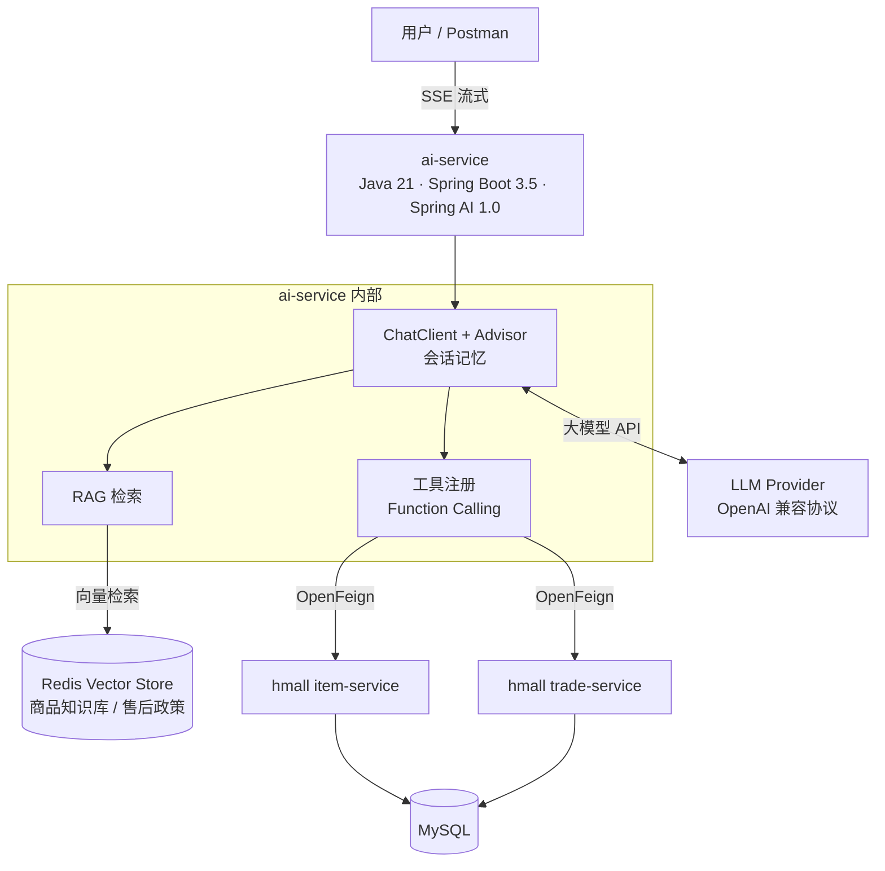
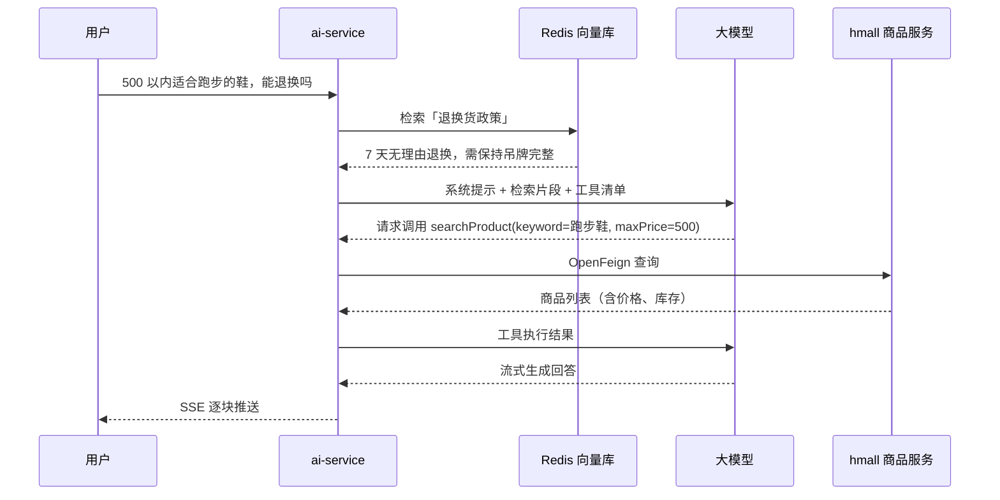

# mall-ai-assistant

> 把 AI 能力接入现有电商微服务系统：用自然语言找商品、查库存、问订单、答售后。

**状态**：🚧 开发中（2026.04 起）　|　**技术栈**：Java 21 · Spring Boot 3.5 · Spring AI 1.0 · Spring Cloud · Redis Vector Store

---

## 这个项目解决什么问题

电商系统里的商品检索和售后咨询，传统做法是「关键词搜索 + 人工客服」。用户真正的表达是「有没有适合跑步的鞋，500 以内，能退换吗」——这句话里有**品类、预算、售后政策**三个意图，关键词搜索只能命中第一个。

这个项目要验证一件事：**能不能在不改动现有交易链路的前提下，用 AI 服务把自然语言请求翻译成「查库 + 查知识库」的组合动作。**

三个典型场景：

| 场景 | 用户说 | 系统要做 |
|---|---|---|
| 商品导购 | 「500 以内适合跑步的鞋」 | 调商品服务按价格与品类过滤，返回 Top N |
| 售后咨询 | 「买错了能退吗」 | 检索售后政策知识库，带出处回答 |
| 订单查询 | 「我昨天的订单到哪了」 | 调订单服务查物流状态 |

## 架构



**分层原则**：

- `ai-service` 只做「理解意图 + 编排调用」，**不直接连商品库**；
- 数据归口仍在原有微服务，AI 层通过 OpenFeign 走既有接口；
- 知识类问题走 RAG，实时数据走工具调用，两者不混用。

## 一次完整调用



## 关键设计决策

> 这一节记录「为什么这么做」，比代码本身更能说明问题。面试时会被追问的也在这里。

**1. AI 服务独立部署，不并入交易微服务**

直接原因是版本约束：hmall 是 Spring Boot 2.7 + Java 11，Spring AI 1.0 要求 Boot 3.x + Java 17+，合并需要把整条链路升到 `jakarta` 命名空间，风险与收益不成比例。

更重要的原因是架构：模型调用有**秒级延迟、按 token 计费、供应商会限流超时**，这三件事都不该和下单链路共享线程池。AI 服务独立后可以单独限流、单独扩容、单独降级——模型挂了不影响交易。

**2. 向量库复用 Redis，不引入 Milvus**

商品知识库是万级 chunk 量级，Redis Stack 的 HNSW 索引完全够用，而 Redis 本来就在 hmall 的依赖里，零新增运维成本。

什么时候该换：需要**混合检索（BM25 + kNN）**或中文分词调优时，ES 的 `dense_vector` 更合适；数据量到百万级 chunk 再考虑专用向量库。

**3. 技术选型用 Spring AI，不用 Python + LangChain**

团队主栈是 Java，为了接 AI 再维护一套 Python 服务，等于把「一次调用」变成「跨语言调用 + 双份部署」。Spring AI 的 `ChatClient` / `Advisor` / `ToolCallbackProvider` 与 Spring Boot 生态无缝，`MethodToolCallbackProvider` 还能直接把 `@Tool` 方法注册成模型可调用的工具。

代价要认：Spring AI 的生态比 LangChain 小，新模型和新范式的接入会慢半拍。**这个代价用「能读懂 Python 侧实现」来对冲，而不是换语言。**

**4. 工具只暴露读操作**

`searchProduct` / `queryStock` / `queryOrder` 全是只读。**不给模型任何写接口**——模型误判的代价是「查错了」，而不是「删了数据」。

每个 `@ToolParam` 的 description 都要写清约束（`limit` 上限、必填条件），否则模型会不带条件全表扫描，一次把整张商品表塞进上下文。

**5. RAG 管文档，工具管实时数据**

这是本项目最核心的一条分工：

- **RAG**：商品参数说明、售后政策、FAQ——相对静态、允许有小时级延迟；
- **工具调用**：库存、价格、订单状态——必须实时，知识库缓存它就会答错。

把实时数据塞进知识库，等于给自己挖一个「回答永远慢半拍」的坑。反过来，把政策文档做成工具也没意义——那是查表不是查库。

**6. 流式输出用 SSE，不用 WebSocket**

AI 回答是单向流式推送，不需要双向通信。SSE 走标准 HTTP，网关、Nginx、浏览器 `EventSource` 全都原生支持，代价是每个连接占一个 HTTP 长连接。

实现上必须避免在 WebMvc 线程里 `Flux.toStream().collect()`——那会把流式变成「等全文生成完再一次性返回」，首字延迟从 300ms 劣化到 8s。正确写法是 `doOnNext` 逐块推、`doOnComplete` 推结束帧。

**7. 凭据全部走环境变量**

模型 API Key、数据库密码、Redis 密码不进仓库。本地用 `.env`，且 `.gitignore` 必须忽略它。

理由不只是「安全规范」：KEY 进过 Git 历史，即使后来删掉也仍可从历史里捞出，只能轮换。

## 目录结构

```
mall-ai-assistant/
├── ai-service/                     # AI 能力层（Boot 3.5 + Java 21），本项目主体
│   ├── src/main/java/com/mall/ai/
│   │   ├── config/                 # Feign、向量库、ChatClient、线程池
│   │   ├── controller/             # /chat/stream（SSE）
│   │   ├── service/                # RAG 检索、工具编排
│   │   ├── tool/                   # @Tool 方法：查商品 / 查库存 / 查订单
│   │   ├── client/                 # OpenFeign → hmall 只读接口
│   │   └── reader/                 # 文档解析与切分
│   └── src/main/resources/prompts/ # 系统提示词模板
├── sql/schema.sql                  # mall_ai 库：5 张表 DDL
├── docs/
│   ├── architecture.md             # 施工图：表结构、SSE 协议、Feign 契约
│   └── demo.md                     # 演示用例与预期输出
└── README.md
```

> **hmall 不在本仓库**。它是黑马商城的课程项目，作为只读基线以独立进程运行（Boot 2.7 + JDK 11）。
> 本仓库只包含自己实现的 AI 能力层；对 hmall 的要求仅限「提供商品 / 订单 / 库存的 GET 接口」，不改动其交易链路。

## 快速开始

> 依赖：JDK 21（ai-service）· JDK 11（hmall，两者独立进程）· MySQL 8 · Redis Stack（第 2 步起需要）· hmall 已在本地运行

```bash
# 1. 建库建表（mall_ai，5 张表）
mysql -u root -p < sql/schema.sql

# 2. 配置凭据（.env 已在 .gitignore 中，不会进仓库）
cp ai-service/.env.example ai-service/.env

# 3. 启动 AI 服务（需要 JDK 21，不能沿用全局 JAVA_HOME 的 JDK 8）
cd ai-service && mvn spring-boot:run
```

**验证**：`curl -N "http://localhost:9090/api/chat/stream"`（第 5 步 SSE 打通后可用）。

## 当前进度

| 模块 | 状态 |
|---|---|
| 架构设计与技术选型 | ✅ 完成 |
| `mall_ai` 建库建表（5 张表） | ✅ 完成 |
| ai-service 骨架（Boot 3.5.15 + JDK 21，可编译可启动） | ✅ 完成 |
| OpenFeign 调通 hmall 商品接口（已用真实 item-service 验证） | ✅ 完成 |
| 商品知识库 RAG（解析 → 切分 → 向量化 → 检索） | 📋 计划 |
| 工具调用（查商品 / 查库存 / 查订单） | 📋 计划 |
| SSE 流式输出 + 会话记忆 | 📋 计划 |
| 演示录屏与文档 | 📋 计划 |

## 已完成的关键取舍（来自前两个原型项目）

这个项目并非从零开始，前两个原型踩过的坑直接决定这里的设计：

- 原型里按空行切分且无长度上限，超长段落会超出 embedding 输入限制导致入库失败 → 这里切分器强制 `chunkSize` 上限；
- 原型里相似度检索用默认 topK 且无阈值，容易召回无关文档 → 这里用 `SearchRequest` 显式设 topK 与阈值；
- 原型里检索为空时只打日志不返回，把空上下文送给模型产生幻觉 → 这里返回业务错误，让上层拒绝回答；
- 原型里工具方法返回 `void` 且吞异常，模型以为调用成功 → 这里工具必须返回「成功 + 数据」或「失败 + 原因」的文本。

## 来源与致谢

- 商品与订单微服务基于 [黑马程序员 hmall 商城](https://github.com/) 二次开发，**AI 能力层为独立实现**；
- 本项目用于验证「AI 能力接入既有 Java 微服务体系」的可行性，不用于生产。

## License

MIT
